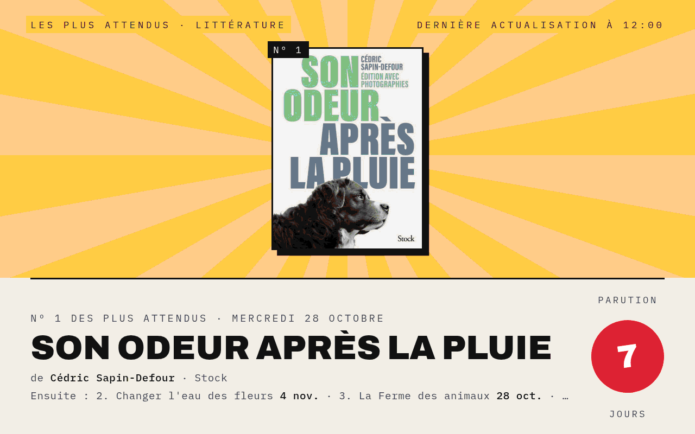
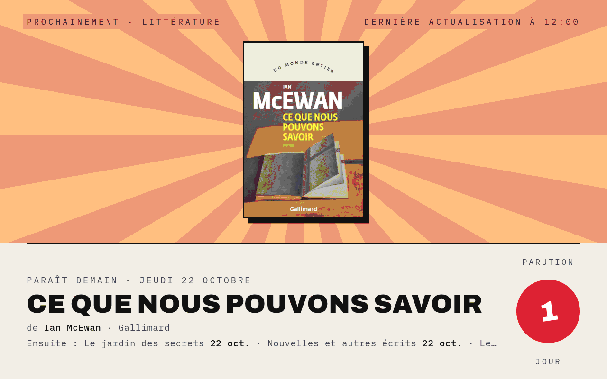
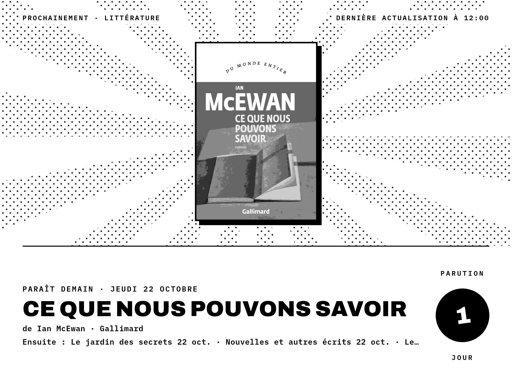
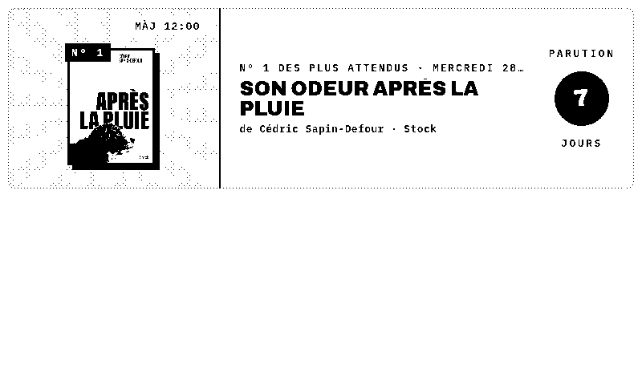
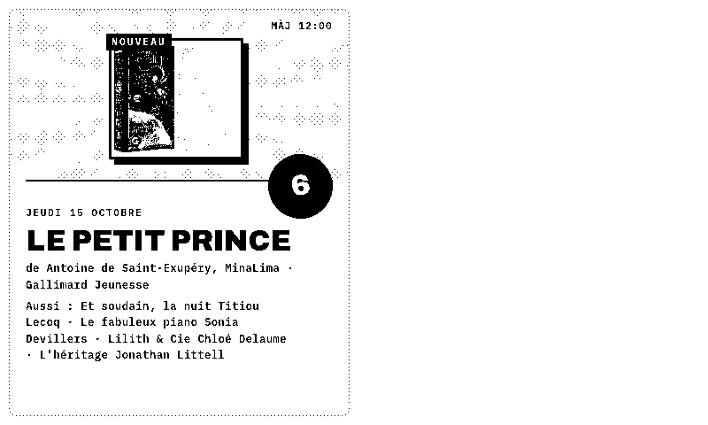
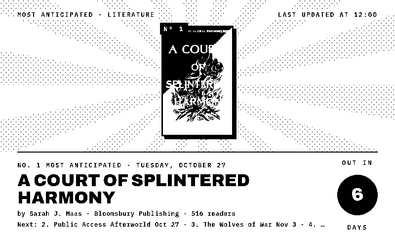
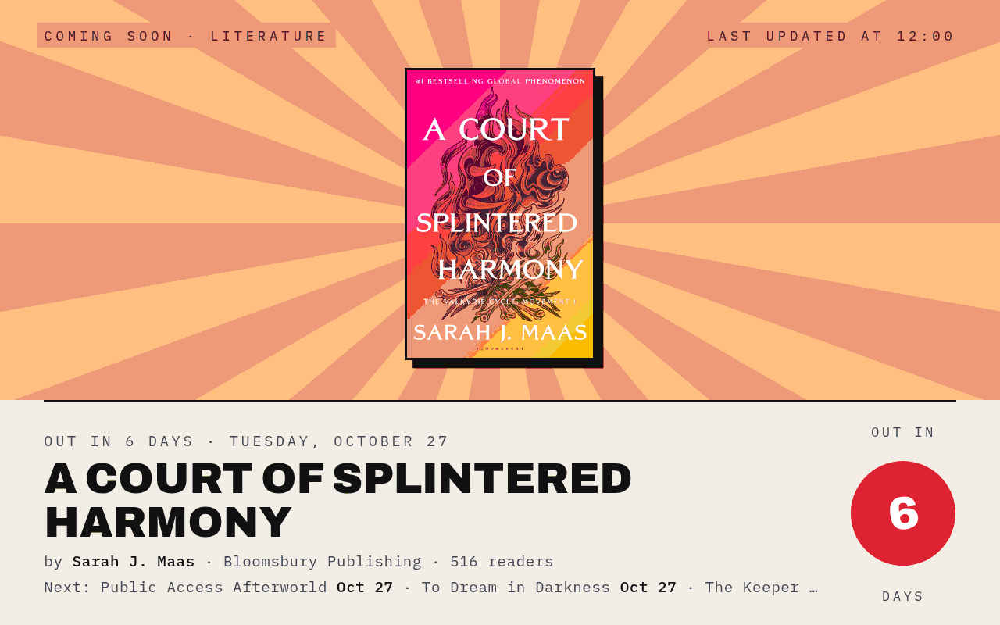
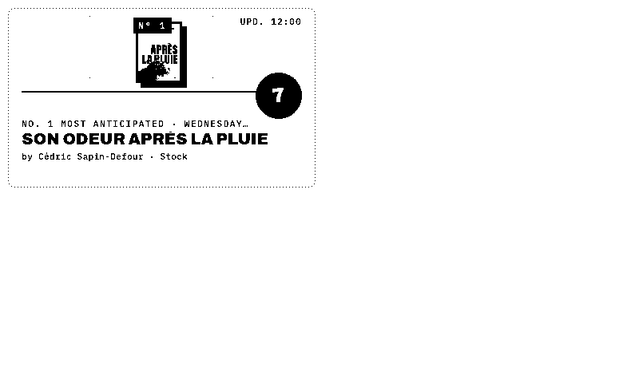

# BookPoster

**[Français](#français) · [English](#english)**

---

## Français

*Ce qui paraît en librairie, façon affiche.*

Un plugin TRMNL qui met un livre à l'affiche : les livres les plus attendus, ceux qui viennent de paraître ou les prochaines parutions, avec sa couverture, son auteur, son éditeur et un compte à rebours avant sa sortie. Il fait partie de la suite Poster avec [FlightPoster](https://github.com/BartoX360/FlightPoster), [WeatherPoster](https://github.com/BartoX360/WeatherPoster), [GamePoster](https://github.com/BartoX360/GamePoster), [MoviePoster](https://github.com/BartoX360/MoviePoster) et [ShowPoster](https://github.com/BartoX360/ShowPoster)dont il reprend le style.

Les sorties ne sont pas les mêmes des deux côtés de la Manche : la langue choisit aussi la source.

- **En français** : les parutions françaises de [Place des Libraires](https://www.placedeslibraires.fr), le site des librairies indépendantes. Aucune clé à fournir.
- **En anglais** : les parutions anglophones de [Hardcover](https://hardcover.app), avec votre propre clé d'API gratuite, et le nombre de lecteurs qui suivent chaque livre.

### Fonctionnalités

- **E-ink et couleur** : un style noir et blanc pur pour les écrans 1 bit (TRMNL OG, TRMNL X) et un style couleur pour les écrans LCD
- **Tous les formats** : plein écran, demi horizontal, demi vertical et quart d'écran (mashups)
- **Trois rubriques**, chacune avec sa couleur de ciel : *Les plus attendus* (doré), *Juste parus* (bleu), *Prochainement* (crépuscule)
- **Rotation** : chaque heure, l'affiche passe à une autre rubrique et à un autre de ses trois premiers livres, ou reste sur la rubrique choisie
- **Tampon** : le nombre de jours avant la parution, ou depuis la parution
- **Vos rayons** : jusqu'à quatre parmi littérature, romans, polar, fantasy & SF, romance, BD, mangas, jeunesse, sciences humaines, arts, vie pratique, ou tous les livres ; leurs listes sont mêlées rang par rang
- **Nouveautés seulement** : les rééditions en poche sont écartées, sauf si vous les voulez (toujours gardées pour les mangas)
- **Français ou anglais**, chacun avec ses propres parutions
- Un livre sans couverture est illustré par un livre ouvert

### Captures

| | |
|---|---|
|  |  |
| E-ink · juste parus | Couleur · prochainement |
|  |  |
| TRMNL X · prochainement | E-ink · livre sans couverture |
|  |  |
| Demi horizontal | Demi vertical |
|  | |
| Couleur · littérature + polar | |

### Installation

> [!NOTE]
> Ce plugin est développé et testé uniquement sur [LaraPaper](https://github.com/usetrmnl/larapaper). Il devrait fonctionner sur usetrmnl.com et les autres serveurs TRMNL, mais il n'y a pas été testé : les retours sont les bienvenus dans les issues.

Pour les parutions anglophones, il faut d'abord une clé d'API Hardcover : sur [hardcover.app](https://hardcover.app), *Settings → Hardcover API → New API Key*.

**LaraPaper / BYOS** : *Plugins → Import recipe*, choisissez `bookposter-x.y.z.zip` dans la [dernière release](https://github.com/BartoX360/BookPoster/releases/latest) (ou zippez le contenu de `recipe/src/`), puis choisissez vos réglages.

**TRMNL (usetrmnl.com)** : créez un *Private Plugin* avec la stratégie *Polling*, puis copiez :
- `polling_url`, `polling_headers` et `polling_body` de `recipe/src/settings.yml` dans *Polling URL*, *Polling headers* et *Polling body* (verbe *POST*) ;
- les `custom_fields` de `recipe/src/settings.yml` dans *Custom fields* (YAML) ;
- `recipe/src/shared.liquid` dans *Shared markup*, et chaque `recipe/src/<format>.liquid` dans l'onglet correspondant.

Le dossier `recipe/src/` suit l'organisation de [trmnlp](https://github.com/usetrmnl/trmnlp). Le plugin est développé et testé sur LaraPaper : sur usetrmnl.com, les réponses HTML et leur taille (jusqu'à 4 Mo) ne sont pas vérifiées.

### Réglages

| Champ | Rôle |
|---|---|
| Clé d'API Hardcover | Seulement en anglais |
| Genres | Les rayons des livres à l'affiche, quatre au plus (Littérature si vide) ; en anglais, ils sont traduits en genres Hardcover |
| Poches | En français : sans (par défaut) ou avec les rééditions en poche |
| Affiche | *Rotation* (chaque heure), ou toujours le livre le plus attendu, le plus demandé des juste parus ou la prochaine parution |
| Langue | Français (Place des Libraires) ou anglais (Hardcover) |
| Style | E-ink (noir et blanc) ou Couleur |

### Fonctionnement

**En anglais**, le polling fait une requête GraphQL à Hardcover avec deux listes de vingt livres au plus dans les genres correspondants : à paraître d'ici six semaines et parus ces deux dernières semaines, triés par nombre de lecteurs qui les ont ajoutés. Soit deux requêtes par heure, pour 5 000 par jour en offre gratuite.

**En français**, Place des Libraires ne cherche que dans un rayon à la fois : l'URL de polling charge deux pages de recherche par rayon (à paraître d'ici six semaines, parus ces deux dernières semaines), triées par pertinence (les livres les plus demandés d'abord). Chaque page pèse environ 450 Ko, d'où la limite de quatre rayons, qui garde la charge sous les 5 Mo acceptés par LaraPaper. Le gabarit n'en garde que l'en-tête des seize premiers livres (titre, auteurs, éditeur, date, EAN) ; la couverture est chargée au moment du rendu d'après l'EAN.

- *Les plus attendus* : les plus demandés parmi ceux qui paraissent d'ici six semaines
- *Juste parus* : parus ces deux dernières semaines, les plus demandés d'abord
- *Prochainement* : les mêmes livres, du prochain à paraître au plus lointain

### Développement

| Fichier | Rôle |
|---|---|
| `dev/recipe_render.sh <dossier>` | Zippe la recette, l'importe dans LaraPaper comme « BookPoster (test) », rend chaque cas de test et copie les PNG dans `<dossier>` ; avec `LIVE=1`, vérifie aussi les listes réelles et la taille de la charge pour quatre rayons, ainsi que Hardcover si `dev/.hardcover_token` existe |
| `dev/recipe_test.php` | Les cas de test (rubrique, rotation, plusieurs rayons, les deux sources, format, appareil, langue, couverture manquante, erreurs, rayon vide), exécutés dans LaraPaper |
| `dev/test_payload.json` | Les listes de littérature et de polar figées le 21 octobre 2026, utilisées par les cas de test |
| `dev/test_payload_en.json` | La réponse Hardcover (littérature) figée le 21 octobre 2026 |
| `dev/.hardcover_token` | Votre jeton Hardcover pour `LIVE=1`, ignoré par git |
| `dev/update.php` | Copie le code de « BookPoster (test) » dans le plugin installé, sans toucher à ses réglages |
| `dev/install.php` | Première installation : importe la recette comme « BookPoster » |

Les scripts visent un serveur LaraPaper en Docker (conteneur `larapaper-app-1`) joignable en SSH, désigné par `LARAPAPER_SSH` (ex. `root@mon-serveur`), dans l'environnement ou dans `dev/.env` (ignoré par git).

### Notes

- L'écran est construit en JavaScript au moment du rendu : le moteur de rendu doit exécuter le JavaScript.
- Place des Libraires refuse les requêtes qui ne se présentent pas comme un navigateur, d'où l'en-tête `User-Agent` du polling.
- Les couvertures sont chargées depuis Place des Libraires au moment du rendu ; en e-ink, elles passent en niveaux de gris, tramés par le moteur de rendu.
- Un rafraîchissement toutes les 60 minutes suffit à faire tourner l'affiche, soit deux pages par rayon et par heure.
- Les données appartiennent à Place des Libraires ; le plugin se contente de les afficher pour un usage personnel.

---

## English

*What's coming out in bookstores, drawn as a poster.*

A TRMNL plugin that puts one book on a poster: the most anticipated books, the ones just out or the next releases, with its cover, author, publisher and a countdown to its release. It is part of the Poster suite with [FlightPoster](https://github.com/BartoX360/FlightPoster), [WeatherPoster](https://github.com/BartoX360/WeatherPoster), [GamePoster](https://github.com/BartoX360/GamePoster), [MoviePoster](https://github.com/BartoX360/MoviePoster) and [ShowPoster](https://github.com/BartoX360/ShowPoster)and shares their look.

Releases differ between English and French books, so the language also picks the source.

- **In English**: English-language releases from [Hardcover](https://hardcover.app), with your own free API key, and how many readers follow each book.
- **In French**: French releases from [Place des Libraires](https://www.placedeslibraires.fr), the French independent bookstores' website. No key needed.

### Features

- **E-ink and color**: a pure black & white style built for 1-bit screens (TRMNL OG, TRMNL X), and a color style for LCD screens
- **Every layout**: full screen, half horizontal, half vertical and quadrant (mashups)
- **Three sections**, each with its own sky color: *Most anticipated* (gold), *Just out* (blue), *Coming soon* (dusk)
- **Rotation**: every hour the poster moves to another section and another of its top three books, or stays on the section you pick
- **Stamp**: the number of days before or since the release
- **Your shelves**: up to four among literature, novels, crime, fantasy & SF, romance, comics, manga, kids, humanities, arts, lifestyle, or all books; their lists are interleaved rank by rank
- **New books only** (French): paperback reissues are left out unless you want them (always kept for manga)
- **English or French**, each with its own releases
- Books without a cover get an open book illustration

### Screenshots

| | |
|---|---|
|  |  |
| E-ink · most anticipated | Color · coming soon |
|  |  |
| Color · just out | Quadrant |

### Installation

> [!NOTE]
> This plugin is built and tested on [LaraPaper](https://github.com/usetrmnl/larapaper) only. It should work on usetrmnl.com and other TRMNL servers, but it has not been tested there: feedback is welcome in the issues.

For English releases, first get a Hardcover API key: on [hardcover.app](https://hardcover.app), *Settings → Hardcover API → New API Key*.

**LaraPaper / BYOS**: *Plugins → Import recipe*, pick `bookposter-x.y.z.zip` from the [latest release](https://github.com/BartoX360/BookPoster/releases/latest) (or zip the contents of `recipe/src/`), then pick your settings.

**TRMNL (usetrmnl.com)**: create a *Private Plugin* with the *Polling* strategy, then copy `polling_url`, `polling_headers` and `polling_body` (verb *POST*), the `custom_fields`, `shared.liquid` and each layout from `recipe/src/`. The plugin is built and tested on LaraPaper; HTML responses of up to 4 MB are not checked on usetrmnl.com.

### Settings

| Field | Purpose |
|---|---|
| Hardcover API key | Needed in English only |
| Genres | The shelves the books come from, four at most (Literature if blank); in English they are matched to Hardcover genres |
| Paperbacks | French only: without (default) or with paperback reissues |
| Poster | *Rotate* (every hour), or always the most anticipated book, the most wanted just-out book or the next release |
| Language | English (Hardcover) or French (Place des Libraires) |
| Style | E-ink (black & white) or Color |

### How it works

**In English**, the polling makes one GraphQL request to Hardcover with two lists of up to twenty books in the matching genres: coming within six weeks and out in the last two weeks, sorted by the number of readers who shelved them. That's two requests an hour against the free plan's 5,000 a day.

**In French**, Place des Libraires searches one shelf at a time: the polling URL loads two search pages per shelf (coming within six weeks, out in the last two weeks), sorted by relevance (the most wanted books first). Each page weighs about 450 KB, hence the four-shelf limit that keeps the payload under LaraPaper's 5 MB. The template keeps only the header of the first sixteen books (title, authors, publisher, date, EAN); the cover is loaded at render time from the EAN.

- *Most anticipated*: the most followed (English) or most wanted (French) books coming out within six weeks
- *Just out*: released in the last two weeks, most wanted first
- *Coming soon*: the same books, from the next release to the furthest

### Notes

- The screen is built with JavaScript at render time, so the renderer must run JavaScript.
- Place des Libraires turns away requests that don't look like a browser, hence the polling `User-Agent` header.
- A refresh interval of 60 minutes keeps the rotation going, two pages per shelf an hour.
- The data belongs to Place des Libraires; the plugin only displays it for personal use.

---

## Licence / License

Code sous licence [MIT](LICENSE). Les données affichées appartiennent à leurs sources respectives. / Code released under the [MIT](LICENSE) license. The data shown belongs to its respective sources.
